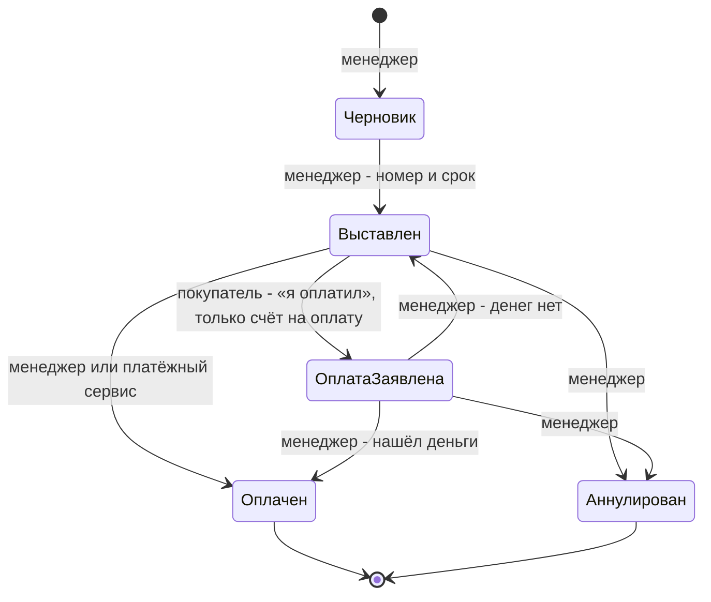
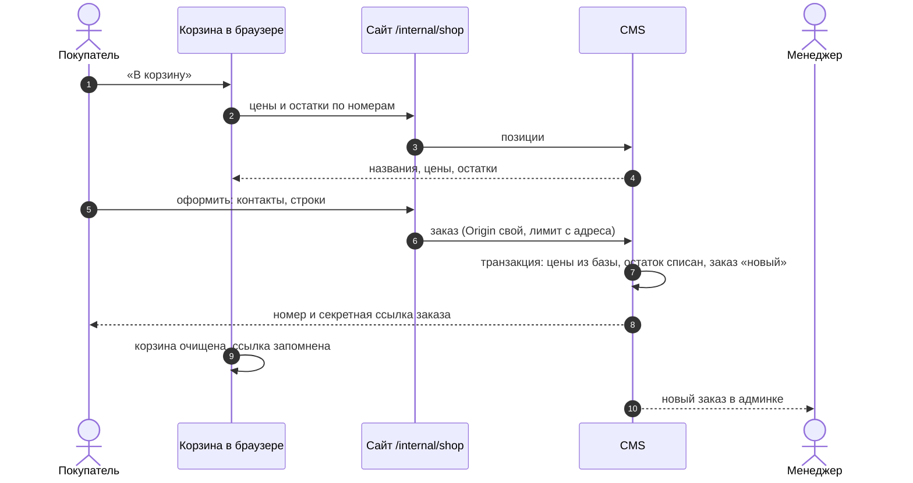
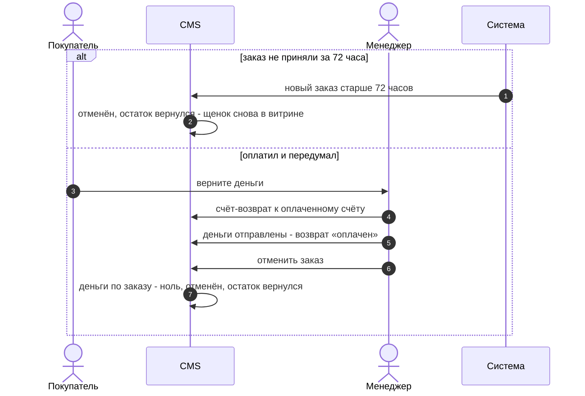

# Магазин: позиции, корзина, заказ, счёт

> **Принят в работу 23.10.2026.** Основа без настроек, всё сверх неё включается
> флагами. Счёт - отдельная сущность со своим автоматом, урезанным до того, что
> нужно сайту.

Модуль даёт любому сайту на шаблоне продавать: учителю курс, блогеру видео, питомнику
щенка, магазину корм и клетки. Оплаты на сайте в основе нет: менеджер выставляет счёт,
покупатель платит переводом или наличными, менеджер подтверждает оплату.

## Словарь

| Слово      | Что значит                                                            |
| ---------- | --------------------------------------------------------------------- |
| позиция    | то, что продаётся: товар, курс, доступ к видео, щенок                 |
| корзина    | позиции и количества, которые посетитель собрал и ещё не заказал      |
| заказ      | что покупатель хочет получить; копия строк корзины и контактов        |
| счёт       | сколько и до какого числа заплатить; у заказа их может быть несколько |
| покупатель | тот, кто оформил заказ; без входа узнаётся по секретной ссылке заказа |
| менеджер   | редактор сайта (вошёл через `users`)                                  |
| система    | плановая проверка сроков; позже - уведомление от платёжного сервиса   |

## Основа

### Позиция

Одна коллекция `offers` на всё, что продаётся.

| Поле       | Что                                                                 |
| ---------- | ------------------------------------------------------------------- |
| название   | как в витрине, в заказе и в счёте                                   |
| цена       | вводится в рублях; пусто - «цена по запросу», в корзину не кладётся |
| картинка   | из медиатеки                                                        |
| описание   | короткий текст для карточки                                         |
| остаток    | пусто - без ограничений; 1 - штучная позиция (щенок)                |
| доступ     | необязательно: доступ к видео (`media-accesses`), который продаётся |
| как купить | в корзину или по заявке                                             |
| бронь      | необязательно: часть цены вперёд, меньше цены                       |

Отдельного режима «штучная» нет: это остаток 1. Позиция с нулевым остатком видна в
витрине с пометкой «нет в наличии».

Позиция в корзину списывает остаток при оформлении заказа. Позиция по заявке держит
его только с момента, когда менеджер принял заказ: продавец сам выбирает, кому продать
щенка или место на курсе, а до тех пор позиция остаётся на витрине для других. Две
заявки на последнюю штуку оформляются обе; принять получается одну, вторая получает
отказ «не хватило» и остаётся новой. Какие строки заказа держат остаток в каком
состоянии, решает одна функция `holdsStock` в contracts, сценарии берут списание и
возврат из `stockMoves`.

У позиции с бронью сначала выставляется счёт на бронь: по строке «Бронь: <позиция>» на
каждую такую позицию заказа. Счёт на бронь у заказа один, пока его не аннулировали, и
доступа к видео он не выдаёт: бронь закрепляет позицию, а не продаёт её. Основной счёт
после живой брони берёт за позицию цену минус бронь; без брони - полную цену. Бронь
записывается в строку заказа при оформлении, поэтому смена брони у позиции уже
оформленный заказ не меняет.

Деньги в магазине считаются по [ADR-002](../adr/002-money.md) и [ADR-003](../adr/003-currencies.md).
В базе цена, суммы строк и итоги - целые микроединицы учёта в полях с единицей в имени
(`priceMicros`, `totalMicros`); владелец вводит и видит рубли, перевод делает поле админки.
Наружу суммы выходят только объектом `Money` в валюте магазина, по курсу на дату
оформления заказа. Поэтому витрина и корзина берут позиции ручкой `/api/shop/offers`,
а не REST коллекции: сырое число из базы сайт не видит.

### Корзина

У гостя живёт в браузере (`localStorage`): номера позиций и количества. Витрина и
корзина берут названия и цены с сервера по номерам; удалённая позиция из корзины
просто пропадает. У вошедшего корзина хранится в учётной записи (расширение
`shop.accounts`).

### Заказ

Контакты покупателя (имя, телефон или почта, комментарий, согласие на обработку
данных) и строки. Сервер берёт цены и остатки из базы в момент заказа, цене из
браузера не верит. Строки записываются копией и после создания не меняются.

Ответ на оформление несёт секретную ссылку заказа. По ней покупатель без входа видит
заказ и его счета; браузер запоминает ссылки своих заказов.

### Счёт

Номер, строки, сумма, срок оплаты, реквизиты получателя из настроек сайта. Строка
с позицией каталога берёт количество из заказа, и менеджер правит в ней только
цену: остаток списан по заказу, и счёт на другое количество развёл бы их. Нужно
другое количество - отменить заказ и оформить новый. Свободные строки (доставка,
наценка за курс) менеджер пишет как хочет. Счёт всегда принадлежит заказу: покупатель
видит его только по ссылке заказа. Продажа, договорённая в переписке, тоже идёт через
заказ - иначе счёту понадобилась бы своя ссылка.

Счёт не создаётся вместе с заказом. Менеджер выставляет его, когда принял заказ и
посчитал то, чего сайт не знает: у мембран это доставка, текущий курс и прочие
расходы. В черновике строки заказа копируются, цены в них правятся, расходы
добавляются своими строками; сумма счёта от заказа не зависит. Выставленный счёт покупатель
видит на странице заказа по секретной ссылке - это основной канал, без почты.
Заказ доходит до «выполнен» и без счёта - наличные при встрече, бесплатный курс.

Доставка счёта - точка подключения: на выставление счёта модуль канала (почта,
Telegram, SMS) отправляет покупателю ссылку. Каналы - отдельные модули, модель
счёта от них не меняется. Пока каналов нет, ссылку при необходимости отправляет
менеджер.

Когда считать нечего, как у видео fitness-mafia, счёт выставляется сам при
оформлении из строк заказа и сразу оплачивается - это расширение `shop.payments`.

Предоплата и остаток - два счёта к одному заказу. Частичной оплаты одного счёта нет:
для неё нужны платежи как сущность и их распределение, а сайту хватает двух счетов.

Возврат денег - счёт-возврат к оплаченному счёту, как кредит-нота в Odoo.
Оплаченный счёт так и остаётся оплаченным, факт поступления денег не теряется.
Счёт-возврат проходит тот же автомат, «оплачен» у него значит «деньги отправлены
покупателю»; оплаченный возврат отзывает доступ по строкам своего счёта. Вернуть
часть денег - возврат на часть суммы.

Просрочка вычисляется: счёт выставлен, а срок прошёл (как фильтр Overdue в Odoo);
состояния под неё нет. Оплатить просроченный можно так же, как любой выставленный.

## Заказ: автомат

```mermaid
stateDiagram-v2
    [*] --> Новый : оформил покупатель - остаток списан
    Новый --> Принят : менеджер
    Новый --> Отменён : менеджер, покупатель; система - не принят за 72 часа
    Принят --> Выполнен : менеджер
    Принят --> Отменён : менеджер - если деньги по заказу возвращены
    Выполнен --> [*]
    Отменён --> [*]
```

| Состояние | Что значит                                                   |
| --------- | ------------------------------------------------------------ |
| новый     | оформлен, остаток списан, менеджер ещё не принял             |
| принят    | менеджер связался и взял в работу; счета выставляются отсюда |
| выполнен  | отгружен, передан, доступ выдан - конечное                   |
| отменён   | остаток вернулся - конечное                                  |

Новый заказ, который менеджер не принял за 72 часа, отменяет система: иначе
оформленный ради шутки заказ держит щенка вне витрины без срока (у Saleor то же
делает состояние EXPIRED).

Отмена возможна, только когда деньги по заказу возвращены: оплаченные счета минус
оплаченные возвраты дают ноль. Открытые счета отменяемого заказа аннулируются,
черновики удаляются.

## Счёт: автомат

Один автомат для счёта на оплату и для счёта-возврата.



| Состояние       | Что значит                                                                        |
| --------------- | --------------------------------------------------------------------------------- |
| черновик        | видит только менеджер; удаляется, а не аннулируется                               |
| выставлен       | покупатель видит счёт и реквизиты; просрочен, если срок прошёл                    |
| оплата заявлена | покупатель сообщил об оплате; менеджер сверяет выписку                            |
| оплачен         | деньги пришли (у возврата - ушли); доступ по строкам выдан или отозван - конечное |
| аннулирован     | счёт отозван до оплаты - конечное                                                 |

Чего в автомате нет и почему: «на проверке» (у сайта один менеджер, проверять
черновик некому), «частично оплачен» (нет платежей как сущности), «просрочен» (это
вычисление), «списан» (бухгалтерия безнадёжных долгов сайту не нужна), «истёк»
(это для предоплаты баланса, а баланса здесь нет), «оплачен -> аннулирован»
(возврат - свой документ).

## Кто что может

| Действие                                                | Кто                                                   |
| ------------------------------------------------------- | ----------------------------------------------------- |
| оформить заказ                                          | посетитель                                            |
| отменить новый заказ                                    | покупатель по ссылке, менеджер, система через 72 часа |
| принять, выполнить, отменить принятый                   | менеджер                                              |
| создать, выставить, удалить черновик счёта или возврата | менеджер                                              |
| «я оплатил»                                             | покупатель по ссылке, только по счёту на оплату       |
| подтвердить оплату                                      | менеджер, платёжный сервис                            |
| отклонить заявку, аннулировать счёт                     | менеджер                                              |

## Инварианты

- **И-1.** Цена, сумма строки и итог заказа считаются на сервере из базы.
- **И-2.** Остаток не уходит ниже нуля: проверка и списание - одна транзакция с
  созданием заказа. Возврат остатка - только переход заказа в «отменён», ровно один раз.
- **И-3.** Строки заказа и выставленного счёта не меняются; количество строки с
  позицией каталога в счёте равно количеству в заказе.
- **И-4.** Из конечных состояний выхода нет; из любого другого есть путь в конечное.
- **И-5.** Доступ к видео выдаётся переходом счёта в «оплачен», ровно один раз на
  строку, и отзывается оплаченным возвратом этого счёта.
- **И-6.** Заказ отменяется, только когда деньги по нему возвращены.
- **И-7.** Покупатель делает только «отменить новый заказ» и «я оплатил» по счёту на
  оплату, и только по секретной ссылке своего заказа.
- **И-8.** Ответ покупателю собирается по полям явно: заметки менеджера и служебные
  поля в него не попадают.

## Как проверяется дизайн

Переходы обоих автоматов - одна таблица в `contracts/src/shop.ts`, и код переходит
только через неё.
`contracts/src/shop.test.ts` обходит в ширину все состояния модели «заказ на щенка,
два счёта, возвраты к ним» при всех действиях всех участников. На каждом состоянии
проверяются И-2, И-5, И-6, из каждого - что путь к развязке (И-4) и к отмене заказа
есть, и что отклонённая заявка оставляет счёт к оплате. Перебор проходит всё за
секунду, решатель не нужен.

Сам тест проверен мутациями: каждая из семи нарочно сломанных строк таблицы (отмена
выполненного, аннулирование оплаченного, подтверждение покупателем, заявка по
возврату, возврат без вычета, отмена принятого системой, отклонение в «аннулирован»)
роняет хотя бы одно свойство.

## Сверка с проверенными моделями

Схема сверена с исходниками Odoo 18 (`sale.order`, `account.move`), Medusa
(`core-flows/order`) и документацией Saleor и Shopify 23.10.2026.

| Взято                                                       | Откуда                                             |
| ----------------------------------------------------------- | -------------------------------------------------- |
| возврат денег - свой документ, оплаченный счёт не трогается | Odoo: кредит-нота - «единственный законный способ» |
| просрочка - вычисление, не состояние                        | Odoo: фильтр Overdue; Shopify: флаг `overdue`      |
| отмена непринятого заказа по сроку, остаток возвращается    | Saleor: `EXPIRED` снимает резерв                   |
| остаток списывается при заказе, возвращается при отмене     | все четыре: резерв в момент заказа                 |
| выполненный заказ не отменяется                             | Saleor, Medusa                                     |

| Не взято                        | Почему                                                 |
| ------------------------------- | ------------------------------------------------------ |
| частичная оплата одного счёта   | два счёта; две платёжки по одному менеджер сверяет сам |
| авторизация и захват платежа    | без эквайринга их нет; придут с `shop.payments`        |
| частичная отгрузка              | заказ остаётся «принят», пока не уедет всё             |
| котировка как состояние заказа  | согласие на цену - оплата счёта                        |
| возврат товара после «выполнен» | редкий случай: остаток правится в позиции руками       |
| правка состава заказа           | другое количество - отменить и оформить заново         |

## Потоки

### Покупка без входа



### Счёт и оплата переводом

```mermaid
sequenceDiagram
    autonumber
    actor М as Менеджер
    participant Д as CMS
    actor П as Покупатель

    М->>Д: заказ «принят»
    М->>Д: счёт из строк заказа, срок
    Д->>Д: черновик → выставлен, номер
    П->>Д: открыл ссылку заказа
    Д-->>П: счёт, реквизиты
    П->>Д: «я оплатил»
    Д->>Д: выставлен → оплата заявлена
    М->>Д: деньги пришли
    Д->>Д: оплачен; строки с доступом - коды видео
    Д-->>П: по ссылке заказа: оплачен, коды
    М->>Д: заказ «выполнен»
```

### Сорвавшаяся продажа щенка



## На сайте

Два блока, ставятся в админке как любые другие:

- «Витрина» - сетка позиций: все или выбранные, с кнопкой «В корзину»;
- «Корзина» - строки, итог и форма оформления.

Части карточки размечены `data-part`, вид меняется в «Виде блока». Страница заказа
`/order/<ссылка>` показывает заказ, счета, реквизиты из настроек сайта («Как оплатить
счёт»), кнопку «я оплатил» и коды доступа; она не индексируется и не отдаёт адрес
дальше (`no-referrer`). Значка корзины в шапке пока нет.

## Слои

Модуль собран по чистой архитектуре: зависимости смотрят внутрь, ядро не знает о
Payload и HTTP (R8, R11).

| Слой     | Где                                      | Что                                                                                                                                                   |
| -------- | ---------------------------------------- | ----------------------------------------------------------------------------------------------------------------------------------------------------- |
| домен    | `contracts/src/shop.ts`                  | таблица переходов, «кто что может», сборка заказа из снимка позиций; чистые функции. В contracts - потому что сайт и CMS спрашивают одни правила (R3) |
| сценарии | `src/cms/src/lib/shop/`                  | оформить, принять, выставить счёт, подтвердить оплату, отменить; по сценарию на файл                                                                  |
| порты    | там же, интерфейсы                       | позиции, заказы, счета, выдача кодов, часы, транзакция                                                                                                |
| адаптеры | `src/cms/src/lib/shop/payload/`          | порты на Payload; в тестах - реализации в памяти                                                                                                      |
| доставка | `/api/shop/*`, `/internal/shop/*`, блоки | только переводят запрос в сценарий и ответ обратно                                                                                                    |

Сценарий знает только порты: заменить CMS - переписать адаптеры.
Расширение добавляет обработчик события («счёт оплачен» -> выдать коды, отправить в
канал) или адаптер порта («платёжный сервис», «канал доставки»); сценарии и домен
при этом не меняются.

## Защита

| Угроза                      | Мера                                                         |
| --------------------------- | ------------------------------------------------------------ |
| подмена цены в браузере     | И-1                                                          |
| поток заказов от бота       | лимит с адреса, скрытое поле, предел размера тела            |
| чужой сайт шлёт заказы      | изменяющий запрос только со своего Origin, через `/internal` |
| перебор ссылок заказов      | секрет 128 бит, в базе только хэш, поиск по хэшу             |
| два покупателя одного щенка | сценарии магазина идут по одному на процесс CMS              |
| покупатель видит служебное  | И-8                                                          |

Предел последней строки: на секунды переключения blue-green работают два процесса CMS,
и их сценарии друг друга не ждут. Сайтам малого бизнеса этого хватает; станет мало -
списание остатка переходит на условную запись в базе («остаток не меньше заказанного»).

## Расширения под флагами

Флаг - запись в `feature-toggles`, владелец переключает её в админке без выкладки.
Флаг заводится в `lib/toggles/system.ts`, когда его возможность готова.

| Флаг                  | Что добавляет                                                                                 | Кому           |
| --------------------- | --------------------------------------------------------------------------------------------- | -------------- |
| `shop.accounts`       | вход покупателя, корзина в учётной записи, история заказов, видео на учётку                   | всем магазинам |
| `shop.members-prices` | цены видны только вошедшим (нужен `shop.accounts`)                                            | мембраны       |
| `shop.filters`        | характеристики, фильтр и поиск ([`44-catalog-search.md`](44-catalog-search.md))               | магазины       |
| `shop.payments`       | оплата на сайте: счёт выставляется при оформлении, платёжный сервис переводит его в «оплачен» | fitness-mafia  |

### Корзина вошедшего

Покупатель кладёт товар с телефона, а оформляет с компьютера: корзина, которой там нет,

- потерянная продажа. Поэтому с `shop.accounts` корзина вошедшего хранится в его учётной
  записи и одинакова на любом устройстве. При входе гостевая корзина вливается в
  сохранённую, одинаковые позиции складываются, браузерная очищается; дальше источник
  правды - сервер. Гостю корзина показывает «Войдите - корзина будет на всех устройствах»:
  без входа телефон и компьютер одного человека серверу не связать.

Порядок расширений - по мере надобности сайтов. Основа от них не зависит.

## Откуда берётся

- Сборка заказа с ценой из базы и копией строк, транзакция, лимиты частоты, проверка
  Origin в прокси, сценарии приёмки Playwright - магазин мембран (`roof-membrane`).
  Мембраны остаются на своём коде, пока не включены нужные им флаги.
