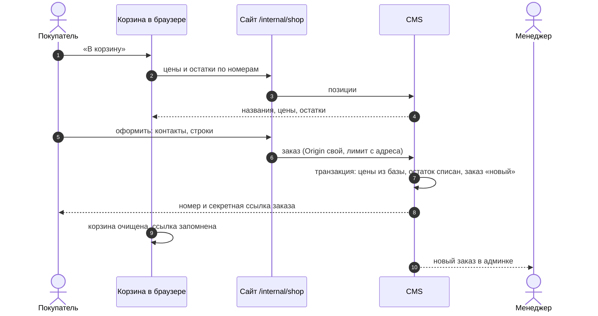
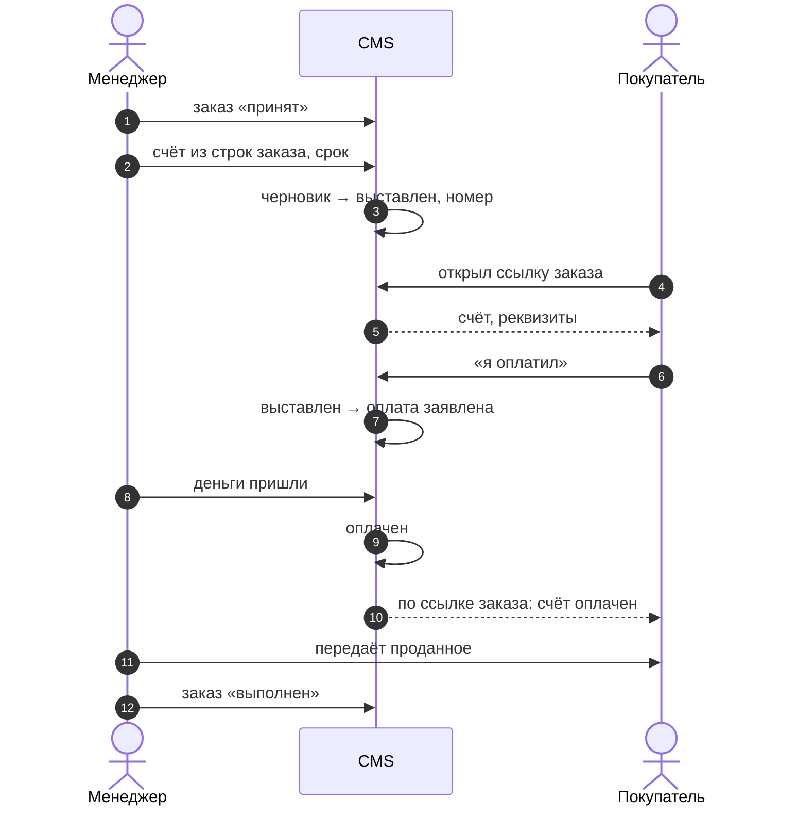
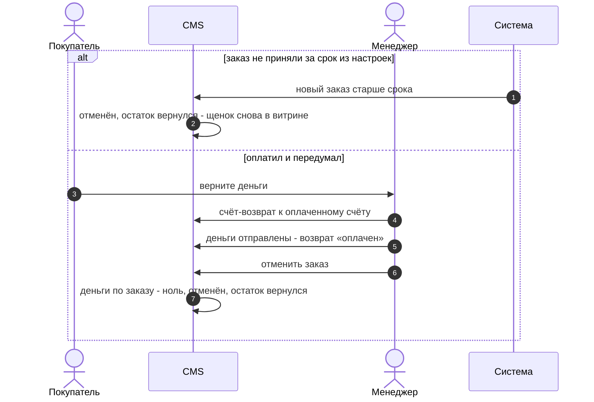
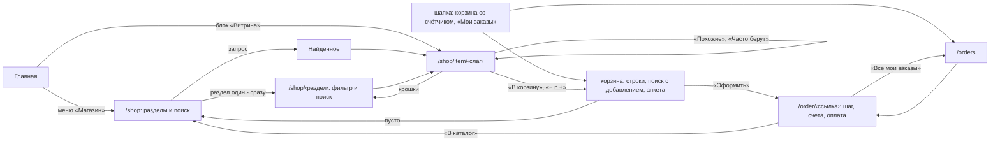

# Магазин: позиции, корзина, заказ, счёт

> **Принят в работу 23.10.2026.** Основа без настроек, всё сверх неё включается
> флагами. Счёт - отдельная сущность со своим автоматом, урезанным до того, что
> нужно сайту. Документ описывает принятое устройство; код догоняет его по задачам
> #167 и #169-#179.

Модуль даёт любому сайту на шаблоне продавать: учителю курс, блогеру видео, питомнику
щенка, магазину корм и клетки. Оплаты на сайте в основе нет: менеджер выставляет счёт,
покупатель платит переводом или наличными, менеджер подтверждает оплату.

## Словарь

| Слово      | Что значит                                                            |
| ---------- | --------------------------------------------------------------------- |
| позиция    | то, что продаётся: запись любой коллекции с возможностью «продаётся»  |
| выдача     | то, что покупатель получает после оплаты; передаёт её продавец        |
| корзина    | позиции и количества, которые посетитель собрал и ещё не заказал      |
| заказ      | что покупатель хочет получить; копия строк корзины и контактов        |
| счёт       | сколько и до какого числа заплатить; у заказа их может быть несколько |
| покупатель | тот, кто оформил заказ; без входа узнаётся по секретной ссылке заказа |
| менеджер   | редактор сайта (вошёл через `users`)                                  |
| система    | плановая проверка сроков; позже - уведомление от платёжного сервиса   |

## Основа

### Позиция

Позицией становится сама запись, которую продают: видео, плейлист, щенок, мембрана.
Владелец отмечает в настройках магазина, какие коллекции сайта продаются, и в карточке
каждой их записи появляется раздел «Продажа». Правка кода сайта для этого не нужна:
название и картинки берутся из самой записи, дубль в отдельной коллекции не заводится.
Коллекция `offers` остаётся для того, у чего своей коллекции нет: консультация, услуга,
шаблон (#167).

| Поле             | Что                                                                 |
| ---------------- | ------------------------------------------------------------------- |
| цена             | вводится в рублях; пусто - «цена по запросу», в корзину не кладётся |
| остаток          | пусто - без ограничений; 1 - штучная позиция (щенок)                |
| как купить       | в корзину или по заявке                                             |
| бронь            | необязательно: часть цены вперёд, меньше цены                       |
| наценка          | необязательно: слой цены позиции (ADR-007), покупателю не видна     |
| скидка           | необязательно: акция на позицию, видна покупателю                   |
| краткое описание | текст карточки на витрине                                           |
| полное описание  | текст страницы позиции, с форматированием                           |
| галерея          | фото и видео; открываются в лайтбоксе и листаются каруселью         |
| характеристики   | значения по набору раздела каталога и свои поля коллекции           |

Отдельного режима «штучная» нет: это остаток 1. Позиция с нулевым остатком видна в
витрине с пометкой «нет в наличии».

Характеристики принадлежат продаваемой записи. Источников два: набор раздела каталога,
который владелец задаёт в админке ([`44-catalog-search.md`](44-catalog-search.md)), и
собственные поля коллекции, отмеченные характеристиками (порода и окрас у собаки).
Фильтр каталога строится по характеристикам продаваемой коллекции.

Магазин не знает, что именно продаёт: в позициях, строках и счетах нет ни доступа
к видео, ни других полей модулей. Выдачу делает продавец: видит оплаченный счёт
и сам передаёт проданное - код к видео, документы, щенка. Связать оплату с выдачей
в модуле проданного - работа системы workflow, в шаблоне её пока нет. Магазин
работает и без выдачи: у консультации её нет вовсе.

Позиция в корзину списывает остаток при оформлении заказа. Позиция по заявке держит
его только с момента, когда менеджер принял заказ: продавец сам выбирает, кому продать
щенка или место на курсе, а до тех пор позиция остаётся на витрине для других. Две
заявки на последнюю штуку оформляются обе; принять получается одну, вторая получает
отказ «не хватило» и остаётся новой. Какие строки заказа держат остаток в каком
состоянии, решает одна функция `holdsStock` в contracts, сценарии берут списание и
возврат из `stockMoves`.

У позиции с бронью сначала выставляется счёт на бронь: по строке «Бронь: <позиция>» на
каждую такую позицию заказа. Счёт на бронь у заказа один, пока его не аннулировали.
Бронь закрепляет позицию за покупателем, продаёт её основной счёт: после живой брони
он берёт за позицию цену минус бронь, без брони - полную цену. Бронь
записывается в строку заказа при оформлении, поэтому смена брони у позиции уже
оформленный заказ не меняет.

Деньги в магазине считаются по [ADR-002](../adr/002-money.md) и [ADR-003](../adr/003-currencies.md).
В базе цена, суммы строк и итоги - целые микроединицы учёта в полях с единицей в имени
(`priceMicros`, `totalMicros`); владелец вводит и видит рубли, перевод делает поле админки.
Наружу суммы выходят только объектом `Money` в валюте магазина, по курсу на дату
оформления заказа. Поэтому витрина и корзина берут позиции ручкой `/api/shop/offers`,
а не REST коллекции: сырое число из базы сайт не видит.

### Корзина

У гостя живёт в браузере (`localStorage`): номера позиций и количества. Строки
сразу рисуются по снимку - карточке, которую покупатель уже видел, - и сервер их
сверяет: названия и цены берутся с него по номерам. «Оформить» становится активной
только после ответа сервера, иначе покупатель согласился бы с ценой, которой уже нет. Позицию, которую удалили или
оставили без цены, корзина убирает сама и пишет об этом покупателю. Пустая корзина
показывает ссылки на заказы, которые браузер запомнил. У вошедшего корзина хранится
в учётной записи (расширение `shop.accounts`).

### Заказ

Контакты покупателя (имя, телефон или почта, комментарий, согласие на обработку
данных) и строки. Сервер берёт цены и остатки из базы в момент заказа, цене из
браузера не верит. Строки записываются копией и после создания не меняются.

Ответ на оформление несёт секретную ссылку заказа. По ней покупатель без входа видит
заказ и его счета; браузер запоминает ссылки своих заказов.

Чего-то нет в наличии - менеджер снимает строку из заказа с причиной («нет в наличии»).
Остаток по снятой строке возвращается, покупатель видит её зачёркнутой с причиной на
странице заказа, счёт выставляется на остальное. Снятие - действие над заказом:
в черновике счёта строку из заказа удалить нельзя. Отменяет заказ менеджер тоже только
с причиной, и покупатель видит её по своей ссылке.

Покупатель может отказаться, пока по заказу нет оплаты: отменить заказ по ссылке,
принятый тоже, и отказаться от выставленного счёта. Оба действия спрашивают
подтверждение в модалке шаблона.

### Счёт

Номер, строки, сумма, срок оплаты, реквизиты получателя из настроек сайта. Строки
у счёта двух видов:

- из заказа - копия строк заказа без снятых; в админке это текст, а не поля:
  позиция, количество, цена и сумма не меняются. Остаток списан по заказу, и счёт на
  другое количество или по другой цене развёл бы заказ и деньги;
- добавленные - второй массив с обычными полями: своя строка с ценой (доставка,
  упаковка), позиция каталога по цене каталога, если покупатель попросил расширить
  заказ, и скидка счёта.

Итог счёта - сумма обоих массивов. Счёт всегда принадлежит заказу: покупатель видит
его только по ссылке заказа. Продажа, договорённая в переписке, тоже идёт через
заказ - иначе счёту понадобилась бы своя ссылка.

Счёт не создаётся вместе с заказом. Менеджер выставляет его, когда принял заказ и
посчитал то, чего сайт не знает: у мембран это доставка и прочие расходы, они
добавляются своими строками. Выставленный счёт покупатель видит на странице заказа по
секретной ссылке - это основной канал, без почты. Заказ доходит до «выполнен» и без
счёта - наличные при встрече, бесплатный курс.

Доставка счёта - точка подключения: на выставление счёта модуль канала (почта,
Telegram, SMS) отправляет покупателю ссылку. Каналы - отдельные модули, модель
счёта от них не меняется. Пока каналов нет, ссылку при необходимости отправляет
менеджер.

Когда считать нечего, как у видео, счёт выставляется сам при оформлении из строк
заказа и сразу оплачивается - это расширение `shop.payments`.

Предоплата и остаток - два счёта к одному заказу. Частичной оплаты одного счёта нет:
для неё нужны платежи как сущность и их распределение, а сайту хватает двух счетов.

Возврат денег - счёт-возврат к оплаченному счёту, как кредит-нота в Odoo.
Оплаченный счёт так и остаётся оплаченным, факт поступления денег не теряется.
Счёт-возврат проходит тот же автомат, «оплачен» у него значит «деньги отправлены
покупателю». Забрать выданное после возврата продавец решает сам. Вернуть часть
денег - возврат на часть суммы.

Просрочка вычисляется: счёт выставлен, а срок прошёл (как фильтр Overdue в Odoo);
состояния под неё нет. Оплатить просроченный можно так же, как любой выставленный.

### Скидки и наценки

Цена считается слоями по [ADR-007](../adr/007-pricing-layers.md). Наценка задаётся
только на позиции: это внутренняя политика менеджера, она уже внутри цены, и покупатель
её не видит ни в карточке, ни в счёте. Скидка бывает в двух местах, и обе покупатель
видит:

- до продажи - акция на позиции; цена по прайсу показывается зачёркнутой, строка
  заказа уже несёт акционную цену;
- при выставлении счёта - строка скидки во втором массиве: промокод, комплимент,
  день рождения. Скидка счёта бывает на строку и на заказ целиком.

Скидка на заказ целиком раскладывается по строкам пропорционально их сумме. Иначе при
частичном возврате или снятии строки нельзя сказать, какая часть скидки уходит вместе
с ней. Скидка не больше суммы, к которой применена.

### Настройки магазина

Вкладка «Магазин» в настройках сайта. Всё здесь - решение владельца, код его не задаёт (R0):

| Настройка                     | Что делает                                                           |
| ----------------------------- | -------------------------------------------------------------------- |
| Название в меню               | пункт меню витрины, появляется сам; по умолчанию «Магазин»           |
| Продаваемые коллекции         | какие коллекции сайта продаются; у их записей раздел «Продажа»       |
| Как оплатить счёт             | текст покупателю у счёта: что сделать после перевода, без реквизитов |
| Получатель                    | название, ИНН, счёт, банк, БИК, корр. счёт - у выставленного счёта   |
| СБП, номер карты              | куда перевести; показывается только заполненное                      |
| Ждать принятия заказа, часов  | непринятый заказ отменяется по истечении, остаток возвращается; 72   |
| Срок оплаты счёта, дней       | срок нового счёта; 0 - без срока; по умолчанию 3                     |
| Что спрашивать при оформлении | телефон и почта: обязательно, по желанию, не спрашивать; комментарий |

Разбирает их одна функция `shopSettings` в contracts: пустое и негодное поле получает значение
по умолчанию, и сценарии, и сайт читают настройки одинаково. Спрятать оба способа связи нельзя -
тогда телефон спрашивается по желанию. Анкету проверяет `checkBuyer` по этим правилам и в
браузере, и на сервере.

## Заказ: автомат

```mermaid
stateDiagram-v2
    [*] --> Новый : оформил покупатель - остаток строк корзины списан
    Новый --> Принят : менеджер - остаток строк заявки списан
    Новый --> Новый : менеджер снимает строку с причиной - её остаток вернулся
    Новый --> Отменён : покупатель; менеджер с причиной; система - не принят за срок
    Принят --> Принят : менеджер снимает строку с причиной - её остаток вернулся
    Принят --> Выполнен : менеджер
    Принят --> Отменён : покупатель - пока оплат нет; менеджер с причиной - деньги возвращены
    Выполнен --> [*]
    Отменён --> [*]
```

| Состояние | Что значит                                                  |
| --------- | ----------------------------------------------------------- |
| новый     | оформлен, остаток строк корзины списан, менеджер не принял  |
| принят    | менеджер взял в работу, остаток заявок списан; отсюда счета |
| выполнен  | отгружен, передан, доступ выдан - конечное                  |
| отменён   | остаток вернулся - конечное                                 |

Новый заказ, который менеджер не принял за срок из настроек магазина (по умолчанию
72 часа), отменяет система: иначе оформленный ради шутки заказ держит щенка вне
витрины без срока (у Saleor то же делает состояние EXPIRED). Позиция по заявке
этой проблемы не создаёт: до принятия она остаток не держит.

Отмена возможна, только когда деньги по заказу возвращены: оплаченные счета минус
оплаченные возвраты дают ноль. Открытые счета отменяемого заказа аннулируются,
черновики удаляются. У отмены менеджером и у снятой строки есть причина, покупатель
видит её на странице заказа. Снятие строки - не состояние, а действие внутри «новый»
и «принят»: строка остаётся в заказе помеченной, её остаток возвращается один раз.

## Счёт: автомат

Один автомат для счёта на оплату и для счёта-возврата.

```mermaid
stateDiagram-v2
    [*] --> Черновик : менеджер
    Черновик --> Выставлен : менеджер - номер и срок
    Выставлен --> ОплатаЗаявлена : покупатель - «я оплатил», только счёт на оплату
    Выставлен --> Оплачен : менеджер или платёжный сервис
    Выставлен --> Аннулирован : менеджер с причиной; покупатель - отказался
    ОплатаЗаявлена --> Оплачен : менеджер - нашёл деньги
    ОплатаЗаявлена --> Выставлен : менеджер - денег нет
    ОплатаЗаявлена --> Аннулирован : менеджер
    Оплачен --> [*]
    Аннулирован --> [*]
```

| Состояние       | Что значит                                                               |
| --------------- | ------------------------------------------------------------------------ |
| черновик        | видит только менеджер; удаляется, а не аннулируется                      |
| выставлен       | покупатель видит счёт и реквизиты; просрочен, если срок прошёл           |
| оплата заявлена | покупатель сообщил об оплате; менеджер сверяет выписку                   |
| оплачен         | деньги пришли (у возврата - ушли) - конечное                             |
| аннулирован     | счёт отозван до оплаты менеджером или покупателем, с причиной - конечное |

Чего в автомате нет и почему: «на проверке» (у сайта один менеджер, проверять
черновик некому), «частично оплачен» (нет платежей как сущности), «просрочен» (это
вычисление), «списан» (бухгалтерия безнадёжных долгов сайту не нужна), «истёк»
(это для предоплаты баланса, а баланса здесь нет), «оплачен -> аннулирован»
(возврат - свой документ).

## Кто что может

| Действие                                                | Кто                                              |
| ------------------------------------------------------- | ------------------------------------------------ |
| оформить заказ                                          | посетитель                                       |
| отменить новый заказ                                    | покупатель по ссылке, менеджер, система по сроку |
| отменить принятый заказ, пока оплат нет                 | покупатель по ссылке, менеджер с причиной        |
| принять, выполнить, снять строку с причиной             | менеджер                                         |
| создать, выставить, удалить черновик счёта или возврата | менеджер                                         |
| выставить счёт на бронь                                 | менеджер, один на заказ                          |
| «я оплатил», отказаться от выставленного счёта          | покупатель по ссылке, только по счёту на оплату  |
| подтвердить оплату                                      | менеджер, платёжный сервис                       |
| отклонить заявку, аннулировать счёт                     | менеджер, аннулировать - с причиной              |

## Инварианты

- **И-1.** Цена, сумма строки и итог заказа считаются на сервере из базы.
- **И-2.** Остаток не уходит ниже нуля: списание - условная запись в базе в том же
  переходе заказа, где строка начинает держать остаток (корзина - оформление, заявка -
  принятие). Возврат остатка - только переход заказа в «отменён», ровно один раз.
- **И-3.** Строки заказа после оформления не меняются; менеджер только снимает строку
  с причиной, и её остаток возвращается один раз. Строки счёта из заказа совпадают со
  снятыми и неснятыми строками заказа по позиции, количеству и цене; в черновике их
  нельзя ни править, ни удалить, добавлять можно только свои строки. Итог и срок
  выставленного счёта не меняются.
- **И-4.** Из конечных состояний выхода нет; из любого другого есть путь в конечное.
- **И-5.** Оплата и возврат меняют только состояния счетов: магазин ничего не выдаёт
  и не отзывает. Что и как передать покупателю, решает продавец.
- **И-6.** Заказ отменяется, только когда деньги по нему возвращены.
- **И-7.** Покупатель делает только «отменить заказ» (новый или принятый, пока нет
  оплат), «я оплатил» и «отказаться» по счёту на оплату, и только по секретной ссылке
  своего заказа.
- **И-8.** Ответ покупателю собирается по полям явно: заметки менеджера, наценки и
  служебные поля в него не попадают.
- **И-9.** Отмена заказа менеджером, снятие строки и аннулирование счёта менеджером
  требуют причину, и покупатель видит её по ссылке заказа.

## Как проверяется дизайн

Переходы обоих автоматов - одна таблица в `contracts/src/shop.ts`, и код переходит
только через неё.
`contracts/src/shop.test.ts` обходит в ширину все состояния модели «заказ на щенка
корзиной или заявкой, два счёта, возвраты к ним» при всех действиях всех участников. На каждом состоянии
проверяются И-2 и И-6, из каждого - что путь к развязке (И-4) и к отмене заказа
есть, и что отклонённая заявка оставляет счёт к оплате. Перебор проходит всё за
секунду, решатель не нужен.

Сам тест проверен мутациями: каждая из семи нарочно сломанных строк таблицы (отмена
выполненного, аннулирование оплаченного, подтверждение покупателем, заявка по
возврату, возврат без вычета, отмена принятого системой, отклонение в «аннулирован»)
роняет хотя бы одно свойство. Так же проверено правило удержания остатка: заявка,
держащая остаток с оформления, и заявка, держащая его только после выполнения,
роняют И-2.

## Сверка с проверенными моделями

Схема сверена с исходниками Odoo 18 (`sale.order`, `account.move`), Medusa
(`core-flows/order`) и документацией Saleor и Shopify 23.10.2026.

| Взято                                                       | Откуда                                             |
| ----------------------------------------------------------- | -------------------------------------------------- |
| возврат денег - свой документ, оплаченный счёт не трогается | Odoo: кредит-нота - «единственный законный способ» |
| просрочка - вычисление, не состояние                        | Odoo: фильтр Overdue; Shopify: флаг `overdue`      |
| отмена непринятого заказа по сроку, остаток возвращается    | Saleor: `EXPIRED` снимает резерв                   |
| остаток списывается при заказе, возвращается при отмене     | все четыре: резерв в момент заказа                 |
| выполненный заказ не отменяется                             | Saleor, Medusa                                     |

| Не взято                        | Почему                                                 |
| ------------------------------- | ------------------------------------------------------ |
| частичная оплата одного счёта   | два счёта; две платёжки по одному менеджер сверяет сам |
| авторизация и захват платежа    | без эквайринга их нет; придут с `shop.payments`        |
| частичная отгрузка              | заказ остаётся «принят», пока не уедет всё             |
| котировка как состояние заказа  | согласие на цену - оплата счёта                        |
| возврат товара после «выполнен» | редкий случай: остаток правится в позиции руками       |
| правка количества в заказе      | другое количество - снять строку и добавить строку     |

Частичное выполнение взято у Озона и DNS: менеджер снимает строку, которой нет, с
причиной, и покупатель платит за остальное, не оформляя заказ заново.

### Витрина, товар и корзина ВсеИнструменты

Разбор vseinstrumenti.ru 23.10.2026 - образец магазина, где покупатель набирает
большой заказ, не уходя со страницы. Берём устройство, а не вёрстку; задачи - #196
(корзина) и #197 (витрина и страница товара).

- Подсказки поиска на любой странице: уточнения запроса чипами, разделы с путём,
  позиции с ценой, счётчиком и добавлением в корзину прямо из подсказки; после
  добавления подсказка остаётся открытой.
- Карточка витрины компактная, четыре в ряд: фото, цена со старой зачёркнутой и
  скидкой, название в две строки, артикул, наличие и срок, «В корзину», пометки из
  данных («Лучшая цена», «Официальный дилер»).
- Раздел: подразделы плитками с картинкой и числом позиций, сортировка, цена ползунком.
- Страница товара: превью фото столбиком, ключевые характеристики рядом с фото и
  ссылка ко всей таблице, блок цены с «В корзину» и «Быстрым заказом», наличие и срок.
- Корзина: выбор строк и «Удалить выбранные», «Поделиться», выгрузка в Excel и печать,
  сопутствующие под строкой, итог с весом и выгодой, промокод.

Не берём сейчас: выбор города и магазина, 360°, рассрочку, сравнение, избранное;
отзывы и вопросы - после входа покупателей (#149).

## Сценарии

Путь покупателя и продавца по шагам, сверенный с Озоном и DNS по их справке. «У нас» -
состояние ветки на 23.10.2026; у каждой дыры задача, по задачам она и закрывается.

### Покупатель

| №   | Сценарий             | Озон и DNS                                                                                                                                                                        | У нас                                                                                                                                                                                                                            | Задача |
| --- | -------------------- | --------------------------------------------------------------------------------------------------------------------------------------------------------------------------------- | -------------------------------------------------------------------------------------------------------------------------------------------------------------------------------------------------------------------------------- | ------ |
| 1   | найти товар          | Озон: поиск и каталог, у отсутствующего - «Похожие». DNS: сначала город, от него цены и наличие. Фильтры справка не описывает                                                     | раздел каталога `/shop/<раздел>` с поиском и фильтром по характеристикам; у витрины-блока поиска нет                                                                                                                             | #150   |
| 2   | карточка товара      | Озон: у закончившегося «Узнать о поступлении». Состав карточки справка не описывает ни у кого                                                                                     | страница `/shop/item/<слаг>`: галерея, описание, характеристики, корзина, «Похожие» и «С этим часто берут»; отзывов нет                                                                                                          | #178   |
| 3   | корзина              | DNS: в корзине меняется количество, товар удаляется, сумма пересчитывается сразу. Озон: корзина хранит товар 30 дней                                                              | в браузере, открывается сразу по снимку; оформить - после сверки цен с сервером, количество сверх остатка урезается с пометкой, проданное остаётся помеченным и в заказ не идёт; иконка со счётчиком в шапке, «− n +» на витрине | -      |
| 4   | оформление без входа | гостевого оформления нет: вход по телефону или почте. DNS: телефон обязателен, почта по желанию. Проверки телефона при оформлении справка не описывает                            | есть; поля по настройкам, телефон проверяется по формату при уходе из поля                                                                                                                                                       | -      |
| 5   | найти заказ снова    | Озон: раздел «Заказы» в кабинете. DNS: номер заказа на последнем экране, «Заказы», телефон магазина; получение по коду из СМС                                                     | секретная ссылка, браузер её помнит, «Мои заказы»; кнопка «скопировать» и пояснение есть, писем нет                                                                                                                              | #152   |
| 6   | оплата               | онлайн (карта, СБП) и при получении. Озон: «Ожидает оплаты» с таймером, неоплаченный отменяется. DNS: может потребовать предоплату, цена фиксируется при подтверждении            | перевод по счёту и «я оплатил»; онлайн-оплаты нет                                                                                                                                                                                | #151   |
| 7   | отмена покупателем   | Озон: «Отменить заказ» на странице заказа с причиной; до 6 ч деньги только заблокированы, потом возврат за 72 ч. DNS: отмены покупателем в правилах нет, только не забрать в срок | новый и принятый, пока нет оплат и заявленной оплаты; от выставленного счёта можно отказаться; подтверждение модалкой шаблона                                                                                                    | -      |
| 8   | отмена части заказа  | Озон: в форме отмены выбираются отдельные товары. Оба сами отменяют часть заказа, остальное едет                                                                                  | частично: строку снимает продавец с причиной, сам покупатель - нет                                                                                                                                                               | #171   |
| 9   | статусы заказа       | Озон: от «Ожидает оплаты» до «Получен» и «Отменено». DNS: списка статусов в справке нет                                                                                           | заказ и его счета со статусами на странице заказа                                                                                                                                                                                | -      |
| 10  | уведомления          | Озон: чат, пуш, почта. DNS: СМС и почта, способ задаётся в профиле; уведомление о подтверждении и готовности                                                                      | нет, ссылку отправляет менеджер сам                                                                                                                                                                                              | #152   |
| 11  | акции и скидки       | Озон: зачёркнутая цена с процентом, купоны и кодовые слова, «Хочу скидку», бонусы продавца. DNS: только бонусы ProZaPass. Скидки ко дню рождения нет ни у кого                    | акция на позиции: цена по прайсу зачёркнутой; скидка в счёте на строку или заказ; слоёв ADR-007 целиком нет                                                                                                                      | #195   |

### Продавец

| №   | Сценарий                     | Озон и DNS                                                                                                                                          | У нас                                                                                                              | Задача |
| --- | ---------------------------- | --------------------------------------------------------------------------------------------------------------------------------------------------- | ------------------------------------------------------------------------------------------------------------------ | ------ |
| 12  | принять заказ                | DNS: подтверждает до 3 рабочих дней, до уведомления договор не заключён. Озон: новый заказ - «Ожидает сборки»                                       | в админке; не принятый за срок отменяется сам                                                                      | -      |
| 13  | счёт юрлицу, срок, просрочка | Озон: счёт юрлицу 7 дней, товар не резервируется. DNS: 2 рабочих дня, при неоплате меняются дата, количество, цена; проверка оплаты по номеру счёта | черновик, выставление, срок от выставления, просрочка вычисляется; реквизиты из настроек; аннулирование с причиной | #172   |
| 14  | отмена продавцом с причиной  | Озон: причина обязательна, покупатель видит «Почему заказ отменён?». DNS: аннулирует за 3 рабочих дня; причину покупателю правила не описывают      | причина обязательна, покупатель видит её на странице заказа                                                        | -      |
| 15  | нет в наличии - снять строку | Озон: «Отменить сборку товара» с причиной, остаток обнуляется. DNS: подтверждает заказ частично                                                     | снятие строки с причиной в админке: остаток вернулся, покупатель видит строку зачёркнутой                          | -      |
| 16  | скидка в счёте, промокод     | Озон: скидка на товар, от суммы заказа, по промокоду, многоуровневая; «Цена до скидки» в карточке акцией не считается                               | скидка вторым списком счёта на строку или заказ, на заказ - с раскладкой по строкам; промокодов нет                | -      |

Источники, 23.10.2026: справка Озона для покупателей
([как сделать заказ](https://docs.ozon.ru/common/moj-zakaz/kak-sdelat-zakaz/),
[где мой заказ](https://docs.ozon.ru/common/moj-zakaz/gde-moj-zakaz/),
[отмена](https://docs.ozon.ru/common/moj-zakaz/kak-otmenit-zakaz/),
[почему отменили](https://docs.ozon.ru/common/moj-zakaz/pochemu-moj-zakaz-otmenili/),
[способы оплаты](https://docs.ozon.ru/common/oplata/payment-ways/),
[юрлицам](https://docs.ozon.ru/common/yuridicheskim-litsam/pokupat-na-ozon/),
[купоны](https://docs.ozon.ru/common/aktsii/kupony-i-kodovye-slova/),
[«Хочу скидку»](https://docs.ozon.ru/common/aktsii-bally-i-bonusy/aktsii/hochu-skidku/),
[уведомления](https://docs.ozon.ru/common/moj-zakaz/notifications/)), база знаний продавца
([управление заказами](https://seller-edu.ozon.ru/libra/fbs/ozon-logistika/upravlenie-zakazami),
[отмена отправления](https://seller-edu.ozon.ru/libra/fbs/orders-cancellations-returns/cancel-shipment),
[акции продавца](https://seller-edu.ozon.ru/libra/ceny-i-akcii/akcii-skidki-i-kupony/akcii-prodavca/my-promo)),
[правила продажи DNS](https://www.dns-shop.ru/rules/rules/) и справка DNS
([как заказать](https://www.dns-shop.ru/help/useful-information/8145d90b-1c3a-44c4-84b9-bb3f54aa783a/),
[оплата](https://www.dns-shop.ru/help/useful-information/f112d810-a586-4c60-b651-8d328fe0e0e7/),
[юрлицам](https://www.dns-shop.ru/help/useful-information/be2e8d34-bb23-4701-83fd-d108469d09cb/),
[ProZaPass](https://www.dns-shop.ru/help/useful-information/e912026f-d8d6-4c69-96cd-a2df05d4f2ca/)).

Оформление без входа остаётся нашим отличием: у Озона и DNS вход обязателен. Найти
заказ снова они дают несколькими путями - кабинет, номер заказа, СМС. У нас путь один,
секретная ссылка: её можно скопировать со страницы заказа, браузер помнит её
в «Моих заказах», а каналов доставки ссылки ещё нет (#152). Причину отмены, снятой строки и аннулированного счёта покупатель видит на странице заказа, как у Озона.
Неоплаченный заказ Озон отменяет по сроку, у нас просроченный счёт оплачивается и
дальше: срок отсчитывается от выставления, просрочку менеджер видит и решает сам.

## Потоки

### Покупка без входа



### Счёт и оплата переводом



### Сорвавшаяся продажа щенка



## На сайте

### Пути покупателя

Каждая страница магазина достижима с главной, и к позиции ведёт не больше трёх
шагов: меню - каталог - раздел - позиция. Схема - то, что проверяет смоук: каждая
стрелка есть на сайте ссылкой или кнопкой.



Пункт «Магазин» появляется в меню сам, пока магазин включён (`siteNav`); подпись
владелец меняет в настройках магазина - «Каталог», «Товары». При одном разделе `/shop` сразу открывает его, и ступени
каталога в крошках нет: вести ей было бы некуда, кроме этой же страницы.

Два блока, ставятся в админке как любые другие:

- «Витрина» - она же каталог: сверху поиск, слева фильтр по характеристикам, разделы по
  адресу `/shop/<раздел>`; плитка позиций на раскладке плиток шаблона, все или выбранные:
  картинка или крупное название, краткое описание, пометка заявки и наличия, цена,
  бронь, кнопка «В корзину» или «Оставить заявку». Позиция, которая уже в корзине,
  показывает счётчик «− n +»;
- «Корзина» - строки со степпером, поиск позиций с добавлением прямо из корзины, итог и
  анкета по настройкам магазина. Анкета до отправки показывает, что из связи
  обязательно («телефон или почта»).

У каждой позиции своя страница: галерея фото и видео в лайтбоксе с каруселью, полное
описание, характеристики, кнопка корзины, отзывы, похожие позиции и «с этим часто
берут». Отзыв пишет вошедший покупатель на купленное (`shop.accounts`).

Когда магазин включён, в шапке появляется иконка корзины со счётчиком, а с ней вход
в «Мои заказы». Пункт меню витрины с названием из настроек магазина появится вместе
с индексной страницей каталога (#150). Адреса `shop`, `order` и `orders` заняты
магазином: страница сайта их не занимает.

Части карточек и строк размечены `data-part`, вид меняется в «Виде блока». Страница
заказа `/order/<ссылка>` пишет следующий шаг по состоянию заказа, показывает счета,
снятые строки и причины, реквизиты из вкладки «Магазин», кнопки «я оплатил»,
«отказаться» и «отменить заказ» и то, что выдали модули; она не индексируется и не
отдаёт адрес дальше (`no-referrer`). Подтверждения спрашивает модалка шаблона, не
системное окно браузера.

## Слои

Модуль собран по чистой архитектуре: зависимости смотрят внутрь, ядро не знает о
Payload и HTTP (R8, R11).

| Слой     | Где                                      | Что                                                                                                                                                   |
| -------- | ---------------------------------------- | ----------------------------------------------------------------------------------------------------------------------------------------------------- |
| домен    | `contracts/src/shop.ts`                  | таблица переходов, «кто что может», сборка заказа из снимка позиций; чистые функции. В contracts - потому что сайт и CMS спрашивают одни правила (R3) |
| сценарии | `src/cms/src/lib/shop/`                  | оформить, принять, выставить счёт, подтвердить оплату, отменить; по сценарию на файл                                                                  |
| порты    | `src/cms/src/lib/shop/ports.ts`          | позиции, заказы, счета, деньги наружу, настройки магазина, часы, транзакция                                                                           |
| адаптеры | `payload-store.ts`                       | порты на Payload; в тестах - `memory-store.ts`                                                                                                        |
| доставка | `/api/shop/*`, `/internal/shop/*`, блоки | только переводят запрос в сценарий и ответ обратно                                                                                                    |

Сценарий знает только порты: заменить CMS - переписать адаптеры.
Других модулей магазин не вызывает и их полей не хранит. Расширение добавляет адаптер
порта («платёжный сервис», «канал доставки»); сценарии и домен при этом не меняются.

## Защита

| Угроза                      | Мера                                                         |
| --------------------------- | ------------------------------------------------------------ |
| подмена цены в браузере     | И-1                                                          |
| поток заказов от бота       | лимит с адреса, скрытое поле, предел размера тела            |
| чужой сайт шлёт заказы      | изменяющий запрос только со своего Origin, через `/internal` |
| перебор ссылок заказов      | секрет 128 бит, в базе только хэш, поиск по хэшу             |
| два покупателя одного щенка | условная запись в базе: «остаток не меньше заказанного»      |
| покупатель видит служебное  | И-8                                                          |

Списание остатка - одна условная запись «уменьшить, если остаток не меньше заказанного»
(`stock.ts`), поэтому двойной продажи нет и между двумя процессами CMS на секунды
переключения blue-green. Транзакции Payload в движке пока пустые (#155): при сбое после
списания сценарий сам возвращает списанное.

## Расширения под флагами

Флаг - запись в `feature-toggles`, владелец переключает её в админке без выкладки.
Флаг заводится в `lib/toggles/system.ts`, когда его возможность готова.

| Флаг                  | Что добавляет                                                                                 | Кому           |
| --------------------- | --------------------------------------------------------------------------------------------- | -------------- |
| `shop.accounts`       | вход покупателя, корзина в учётной записи, история заказов, видео на учётку                   | всем магазинам |
| `shop.members-prices` | цены видны только вошедшим (нужен `shop.accounts`)                                            | мембраны       |
| `shop.filters`        | характеристики, фильтр и поиск ([`44-catalog-search.md`](44-catalog-search.md))               | магазины       |
| `shop.payments`       | оплата на сайте: счёт выставляется при оформлении, платёжный сервис переводит его в «оплачен» | fitness-mafia  |

### Корзина вошедшего

Покупатель кладёт товар с телефона, а оформляет с компьютера, и корзина, которой там нет,
оборачивается потерянной продажей. Поэтому с `shop.accounts` корзина вошедшего хранится в
его учётной записи и одинакова на любом устройстве. При входе гостевая корзина вливается в
сохранённую, одинаковые позиции складываются, браузерная очищается; дальше источник
правды - сервер. Гостю корзина показывает «Войдите - корзина будет на всех устройствах»:
без входа телефон и компьютер одного человека серверу не связать.

Порядок расширений - по мере надобности сайтов. Основа от них не зависит.

## Откуда берётся

- Сборка заказа с ценой из базы и копией строк, транзакция, лимиты частоты, проверка
  Origin в прокси, сценарии приёмки Playwright - магазин мембран (`roof-membrane`).
  Мембраны остаются на своём коде, пока не включены нужные им флаги.
